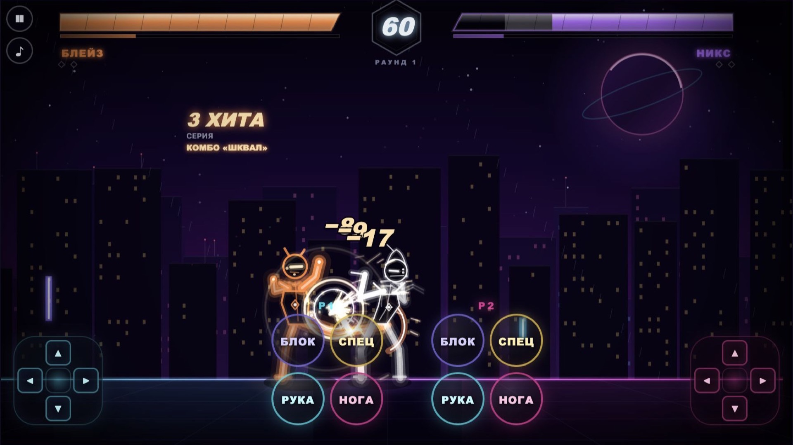
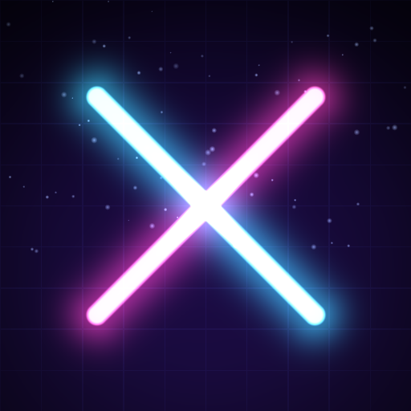

# NEON CLASH

Неоновый 2D-файтинг для Android и мобильного браузера. MVP: один игрок против ИИ или двое на одном телефоне, неоновая векторная графика, синтезированный звук, APK через Capacitor.





## Что уже есть

- **Бой 1 на 1** на неоновой крыше: здоровье, таймер 60 секунд, бой до двух побед.
- **Два режима**: против ИИ и локально вдвоём на одном экране.
- **Удары**: рука (быстрый, промахивается по присевшему), нога (сильный, пробивает присед), спец-снаряд за 50 энергии.
- **Блок** с чип-уроном, присед, прыжки, воздушная атака, серии ударов.
- **Энергия** растёт от попаданий и блоков, переносится между раундами.
- **Мобильное управление**: два джойстика и кнопки, поддержка мультитача, safe-area, блокировка скролла и контекстного меню.
- **Эффекты**: хитстоп, тряска, вспышки, частицы, отражения, дождь, неоновые вывески.
- **PWА + Android**: манифест, service worker, полноэкранный режим, ландшафтная ориентация, immersive mode.
- **Звук и музыка** генерируются WebAudio — внешних файлов нет.
- Клавиатура для отладки на компьютере.

## Быстрый запуск в браузере

```bash
npm run dev
# открыть http://127.0.0.1:5180
```

Для проверки на телефоне в той же Wi-Fi сети:

```bash
npm run serve
# открыть http://<IP-компьютера>:5180 с телефона
```

На телефоне включите полноэкранный режим и поверните экран горизонтально.

## Управление

### Один игрок (телефон)

| Элемент | Действие |
| --- | --- |
| Левый джойстик | движение; вверх — прыжок, вниз — присед |
| РУКА | быстрый удар |
| НОГА | сильный удар |
| БЛОК | держать для защиты (в воздухе не работает) |
| СПЕЦ | снаряд за 50 энергии |

### Два игрока (один телефон)

Экран делится на две половины. У каждого свой джойстик и кнопки. Игрок 1 — слева (бирюзовый), игрок 2 — справа (розовый).

### Клавиатура (для разработки)

- P1: `A` `D` — движение, `W` — прыжок, `S` — присед, `F` — рука, `G` — нога, `H` — блок, `T` — спец.
- P2: стрелки, `1` — рука, `2` — нога, `3` — блок, `4` — спец.
- `Esc` / `P` — пауза, `Enter` — быстрый старт 1P из меню.

## Сборка APK

Нужны: Node.js 22+, JDK 21, Android SDK с platform 36 и build-tools 36.

Самый простой путь (сам найдёт Homebrew JDK 21 и Android SDK):

```bash
npm install
npm run apk
```

Либо вручную:

```bash
export JAVA_HOME="$(brew --prefix openjdk@21)/libexec/openjdk.jdk/Contents/Home"
export ANDROID_HOME="$HOME/Library/Android/sdk"

npm install
npx cap sync android
cd android
./gradlew assembleDebug
```

Готовый APK: `android/app/build/outputs/apk/debug/app-debug.apk`.
Собранный MVP также лежит в `dist/NeonClash-MVP.apk`.

Установка на подключённый телефон:

```bash
adb install -r dist/NeonClash-MVP.apk
```

В проекте уже настроен Gradle 9.5 (wrapper) и AGP 8.13. Сборка проверена на JDK 21 — если используете другую версию JDK, поставьте 21.

### Что настроено в Android-проекте

- `screenOrientation="sensorLandscape"` — только горизонтальная ориентация.
- Immersive mode в `MainActivity`: скрыты статус-бар и навигация, экран не гаснет.
- Тёмный фон, кастомные иконки и splash.
- Capacitor 8, `webDir: www`.

После изменений в `www/` выполняйте `npx cap sync android` (или `npm run cap:sync`), иначе APK соберётся со старой версией веба. В debug-сборке включена отладка WebView: `chrome://inspect`.

## Структура

```
www/
  index.html          разметка меню, HUD-оверлеев и сенсорных кнопок
  styles.css          неоновый UI, адаптив под телефон
  js/
    main.js           меню, пауза, звук, fullscreen, wake lock
    game.js           игровой цикл, раунды, физика столкновений, HUD, фон
    fighter.js        состояния бойца, удары, хитбоксы, процедурная отрисовка
    ai.js             ИИ: дистанция, блок, прыжки, удары
    input.js          Controller, TouchController, клавиатура, MergeController
    fx.js             частицы, кольца, урон, тряска, хитстоп
    audio.js          WebAudio-синтез SFX и synthwave-луп
  manifest.webmanifest
  sw.js               офлайн-кэш
  icons/
scripts/
  make-icons.mjs      генерация PNG-иконок без зависимостей
android/              нативный проект Capacitor
```

## Где настраивать баланс

- Параметры ударов: `www/js/fighter.js` → `ATTACKS` (стартап, активные кадры, урон, дальность, отдача).
- Поведение ИИ: `www/js/ai.js` (вероятности блока, дистанции, кулдауны).
- Длительность раунда и побед: `www/js/game.js` → `ROUND_TIME`, `WINS_NEEDED`.
- Скорость/прыжок: `GRAVITY`, `WALK_SPEED`, `JUMP_V` в `fighter.js`.

## Bluetooth / игра по сети

Сейчас режим «2 игрока» — локальный, на одном устройстве. Архитектура уже готова к сетевому вводу: игра принимает любой объект с методами `isDown(action)` и `consume(action)` (`Controller` в `input.js`), а бойцы ничего не знают об источнике ввода.

Важное ограничение: **браузерный Web Bluetooth не умеет Bluetooth Classic и не даёт Android-телефону быть BLE-периферией**, поэтому честный «коннект по блютузу» между двумя телефонами в PWA/WebView невозможен. Варианты на следующий этап:

1. **Android-плагин на Kotlin** (Bluetooth Classic RFCOMM или BLE GATT с ролью peripheral) + Capacitor-плагин. Протокол простой: 6 байт состояния ввода 30–60 раз в секунду, хост считает симуляцию и рассылает состояние.
2. **WebRTC / Nearby Connections** — проще и стабильнее: два телефона в одной Wi-Fi сети или на хотспоте, сигналинг через комнату/QR. Для APK можно использовать `@capacitor-community/nearby-connections` (Android Nearby Connections умеет Bluetooth + Wi-Fi).
3. Для быстрого теста — **WebSocket-сервер** (`ws`) и два телефона в одной сети, затем заменить транспорт на BLE/Nearby.

Точка интеграции: реализовать `RemoteController extends Controller`, который обновляет `state` и вызывает `press()` из сетевых пакетов, и передать его в `Game` вместо `p2`. Локальный экран можно оставить как «второй игрок на телефоне-хосте» или убрать.

## Roadmap MVP → v1

- [ ] Выбор сложности ИИ (лёгкий / средний / сложный).
- [ ] Bluetooth/Nearby-мультиплеер на двух телефонах.
- [ ] Больше бойцов с разными спец-атаками.
- [ ] Тренировка и список приёмов.
- [ ] Настройки: громкость, вибрация, размер кнопок.
- [ ] Сохранение рекордов и прогресса.
- [ ] Release-подпись APK/AAB и публикация.

## Лицензия

Код MVP можно использовать и изменять свободно. Иконки и графика процедурные, сгенерированы в проекте.
