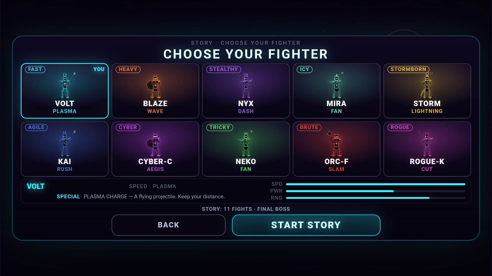
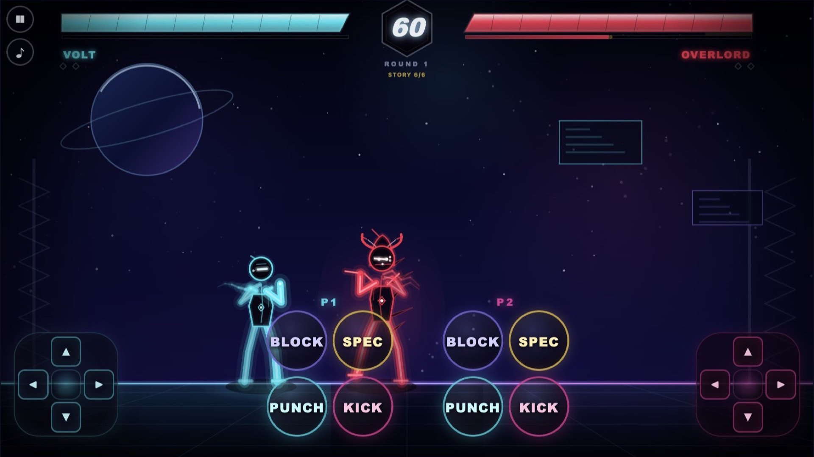

# NEON CLASH

Неоновый 2D-файтинг для Android и мобильного браузера. Десять бойцов и босс с разными стилями и спец-атаками, бой против ИИ или двое на одном телефоне, пиксельно-неоновая графика, OGG-музыка и синтезированные звуки, APK через Capacitor.







## Документация

- [Архитектура проекта](docs/ARCHITECTURE.md) — модули, игровой цикл, бойцы, сеть, аудио, рендеринг и точки расширения.
- [Ассеты и форматы](docs/ASSETS.md) — музыка OGG, SFX, спрайты, иконки и правила добавления файлов.
- [Инструкция для агентов](AGENTS.md) — правила работы, карта репозитория, проверки и Definition of Done.
- [KAI: бриф для спрайтов](docs/CHARACTER_KAI.md) — палитра, силуэт, анимации и формат кадров.

## Что уже есть

- **Бой 1 на 1** на неоновой крыше: здоровье, таймер 75 секунд, бой до двух побед.
- **Длина раунда на выбор**: быстрый (≈8 ударов до нокаута), обычный (≈12) или долгий (≈18). Выбор — в меню и сохраняется на устройстве.
- **Десять бойцов + босс**: Вольт, Блейз, Никс, Мира, Сторм, Кай, Кибер-Си, Неко, Орк-Ф и Роуг-К. У каждого свой силуэт, статы и спец-атака; выбор бойца перед каждым боем.
- **Режим истории**: выбери бойца и пройди всех соперников, своего двойника и финального босса **OVERLORD**.
- **Три режима**: против ИИ, локально вдвоём на одном экране и **по Bluetooth/рядом** на двух телефонах.
- **8 языков интерфейса**: English (по умолчанию), Русский, Español, Português, Français, Deutsch, 中文, 日本語. Переключатель — в правом верхнем углу главного меню.
- **Удары**: рука (быстрый, промахивается по присевшему), нога (сильный, пробивает присед), спец-атака за 50 энергии.
- **Комбо**: «Двойка», «Крюк», «Смена», «Шквал», «Тройка», «Двойная нога», «Реверс».
- **Командные приёмы в духе MK**: ВПЕРЁД-ВПЕРЁД+удар, ВПЕРЁД-ВНИЗ-НАЗАД+удар, ВНИЗ-ВПЕРЁД+рука, ВНИЗ-НАЗАД+нога.
- **Шпаргалка в паузе**: список комбо, командных приёмов и спец-атаки текущего бойца.
- **Блок** с чип-уроном, присед, прыжки, воздушная атака, серии ударов.
- **Крестовина** вместо аналогового джойстика — четыре направления с подсветкой нажатия.
- **Энергия** растёт от попаданий и блоков, переносится между раундами.
- **Мобильное управление**: две крестовины и кнопки, поддержка мультитача, safe-area, блокировка скролла и контекстного меню.
- **VS-заставка**: перед каждым боем — полноэкранный экран с изображениями бойцов, именами, титулами и VS-плашкой.
- **Случайные арены**: десять арен — неоновый город, закатное додзё, токсичный реактор, орбитальная станция, ледяная тундра, пустоши, неоновая улица, чёрный рынок, космический док и неоновый файт-клуб. Мир шире экрана: камера следует за боем, фон движется с параллаксом.
- **Эффекты**: хитстоп, тряска, вспышки, частицы, отражения, дождь, снег, лепестки и неоновые вывески.
- **PWA + Android**: манифест, service worker, полноэкранный режим, ландшафтная ориентация, immersive mode.
- **8 музыкальных тем**: меню, пять базовых треков арен, финальный босс и победа. Новые фото-арены переиспользуют эти треки. Файлы лежат в `www/audio` в OGG; если файл не загрузился, включается синтезированный fallback.
- **Звук** синтезируется WebAudio — удары, блок, спец-приёмы и победа.
- Клавиатура для отладки на компьютере.

## Бойцы

| Боец | Стиль | HP | Спец |
| --- | --- | --- | --- |
| **ВОЛЬТ** | быстрый, 340 | 100 | **Плазменный заряд** — летящий снаряд |
| **БЛЕЙЗ** | тяжёлый, 300, +12% урона | 112 | **Ударная волна** — идёт по земле, её можно перепрыгнуть |
| **НИКС** | ассасин, 355 | 96 | **Теневой рывок** — быстрый рывок сквозь соперника |
| **МИРА** | зонер, 315 | 100 | **Ледяной веер** — три осколка: вверх, вперёд и вниз |
| **СТОРМ** | грозовой, 320 | 104 | **Небесный разряд** — молния бьёт в точку, успей уйти |
| **КАЙ** | энергетический, 370 | 92 | **Искровой рывок** — молниеносный рывок |
| **КИБЕР-СИ** | кибер-танк, 300 | 118 | **Волна Эгиды** — тяжёлая волна по земле |
| **НЕКО** | дух-зонер, 340 | 96 | **Веер духов** — три осколка |
| **ОРК-Ф** | яростный брут, 285 | 126 | **Землетрясение** — удар по земле |
| **РОУГ-К** | теневой клинок, 360 | 94 | **Теневой разрез** — рывок с клинками |

Только в режиме истории появляется дополнительный персонаж — босс **OVERLORD**: 150 HP, +40% урона, ускоренные атаки и увеличенный размер. В выборе игроков его нет.

В режиме **1 игрок** вы выбираете бойца, ИИ получает случайного другого. В режиме **2 игрока** каждый выбирает на вкладке P1 или P2; можно выбрать одного и того же бойца — будет зеркальный бой, а P2 получит альтернативную палитру. Выбор запоминается.

## Быстрый запуск в браузере

```bash
npm run dev
# открыть http://127.0.0.1:5180
```

Для проверки на телефоне в той же Wi-Fi сети:

```bash
npm run serve
# открыть http://<IP-компьютера>:5180 с телефона
```

На телефоне включите полноэкранный режим и поверните экран горизонтально.

## Языки

По умолчанию интерфейс английский. Язык выбирается в главном меню и сохраняется на устройстве. Переведены меню, помощь, выбор бойца, HUD, результаты боя, комбо, экран связи и системные статусы Bluetooth/BLE.

Поддерживаются: **English**, **Русский**, **Español**, **Português**, **Français**, **Deutsch**, **中文**, **日本語**.

## Управление

### Один игрок (телефон)

| Элемент | Действие |
| --- | --- |
| Крестовина | движение; вверх — прыжок, вниз — присед |
| РУКА | быстрый удар |
| НОГА | сильный удар |
| БЛОК | держать для защиты (в воздухе не работает) |
| СПЕЦ | особая атака за 50 энергии |

У каждого бойца своя спец-атака: плазма, волна, рывок, ледяной веер или молния.

### Комбо

Комбо собираются из обычных ударов, если первый удар попал:

| Ввод | Название | Эффект |
| --- | --- | --- |
| РУКА → РУКА | «Двойка» | второй удар сильнее и быстрее |
| РУКА → КИК | «Крюк» | усиленный завершающий удар |
| НОГА → РУКА | «Смена» | быстрый ответ после ноги |
| РУКА → РУКА → НОГА | «Шквал» | сильный финишер с отбросом |
| РУКА → РУКА → РУКА | «Тройка» | третья рука пробивает защиту темпом |
| НОГА → НОГА | «Двойная нога» | быстрый двойной удар ногой |
| НОГА → РУКА → НОГА | «Реверс» | длинная серия с разворотом |

Комбо работает только по попаданию: если первый удар ушёл в блок или мимо, цепочка сбрасывается. Окно продолжения увеличено, а ввод буферизуется во время анимации.

### Командные приёмы

Направления считаются относительно взгляда бойца. Приёмы не требуют энергии, но у них дольше замах.

| Ввод | Приём | Эффект |
| --- | --- | --- |
| ВПЕРЁД, ВПЕРЁД + РУКА | «Рывок» | быстрый рывок с ударом |
| ВПЕРЁД, ВПЕРЁД + НОГА | «Таран» | длинный разгон и сильный удар |
| ВНИЗ, ВПЕРЁД + РУКА | «Апперкот» | подбрасывает соперника |
| ВНИЗ, НАЗАД + НОГА | «Подсечка» | низкий удар, сбивает с ног |
| ВПЕРЁД, ВНИЗ, НАЗАД + удар | «Пробой» | мощный удар, пробивает блок |

Движения стали живее: покачивание корпуса в стойке, более выраженный шаг, защитная стойка, реакция на удар и приземление с приседанием.

### История (один игрок)

1. В меню выбери **ИСТОРИЯ** и своего бойца.
2. Соперники идут по ростеру: все остальные бойцы по очереди.
3. Предпоследний бой — зеркальный: против тебя выходит твой же боец в другой палитре.
4. Последний бой — **OVERLORD**, босс, которого нет в выборе игроков: больше здоровья, выше урон, быстрее атаки и заметно крупнее визуально.

После победы нажми **СЛЕДУЮЩИЙ БОЙ**, после поражения — **ПОВТОРИТЬ**. Прогресс истории хранится только в текущей сессии.

### Два игрока (один телефон)

Экран делится на две половины. У каждого своя крестовина и кнопки. Игрок 1 — слева, игрок 2 — справа. Перед боем P1 и P2 выбирают бойцов на вкладках; можно устроить зеркальный бой.

### Bluetooth / рядом (два телефона)

1. В меню нажми **ПО BLUETOOTH** и выбери бойца.
2. Выбери способ связи: **NEARBY** (Bluetooth + Wi-Fi, рекомендуется) или **ПРЯМОЕ BLE** (только Bluetooth).
3. На первом телефоне — **СОЗДАТЬ ИГРУ** (хост), на втором — **ПОДКЛЮЧИТЬСЯ** и выбери найденный телефон.
4. Разреши доступ к Bluetooth и устройствам рядом. Когда соперник подключится, хост нажимает **НАЧАТЬ БОЙ**.

Управление у каждого игрока такое же, как в режиме одного игрока. На обоих экранах показывается весь бой, но симуляцию считает хост. Если связь на секунду пропала, бой ставится на паузу, телефоны автоматически переподключаются и продолжают с того же места.

### Клавиатура (для разработки)

- P1: `A` `D` — движение, `W` — прыжок, `S` — присед, `F` — рука, `G` — нога, `H` — блок, `T` — спец.
- P2: стрелки, `1` — рука, `2` — нога, `3` — блок, `4` — спец.
- `Esc` / `P` — пауза, `Enter` — открыть выбор бойца из меню.

## Сборка APK

Нужны: Node.js 22+, JDK 21, Android SDK с platform 36 и build-tools 36.

Самый простой путь (сам найдёт Homebrew JDK 21 и Android SDK):

```bash
npm install
npm run apk
```

Либо вручную:

```bash
export JAVA_HOME="$(brew --prefix openjdk@21)/libexec/openjdk.jdk/Contents/Home"
export ANDROID_HOME="$HOME/Library/Android/sdk"

npm install
npx cap sync android
cd android
./gradlew assembleDebug
```

Готовый APK: `android/app/build/outputs/apk/debug/app-debug.apk`.
Собранный APK также лежит в `dist/NeonClash.apk`.

Установка на подключённый телефон:

```bash
adb install -r dist/NeonClash.apk
```

В проекте уже настроен Gradle 9.5 (wrapper) и AGP 8.13. Сборка проверена на JDK 21 — если используете другую версию JDK, поставьте 21.

### Что настроено в Android-проекте

- `screenOrientation="sensorLandscape"` — только горизонтальная ориентация.
- Immersive mode в `MainActivity`: скрыты статус-бар и навигация, экран не гаснет.
- Тёмный фон, кастомные иконки и splash.
- Capacitor 8 + Nearby Connections и прямой BLE-плагин для игры на двух телефонах, разрешения Bluetooth/устройства рядом.
- `scripts/fix-ble-gradle.mjs` убирает устаревший `jcenter()` из Gradle-файла BLE-плагина (Gradle 9 его не поддерживает); скрипт запускается автоматически при `npm install` и перед сборкой APK.
- `webDir: www`.

После изменений в `www/` выполняйте `npx cap sync android` (или `npm run cap:sync`), иначе APK соберётся со старой версией веба. В debug-сборке включена отладка WebView: `chrome://inspect`.

## Структура

```
www/
  index.html          разметка меню, HUD-оверлеев и сенсорных кнопок
  styles.css          неоновый UI, адаптив под телефон
  js/
    main.js           меню, пауза, звук, fullscreen, wake lock, сценарии экранов
    i18n.js           переводы интерфейса и игровых надписей (8 языков)
    game.js           игровой цикл, раунды, физика, HUD, арены, история, гостевой рендер
    fighter.js        состояния бойца, удары, комбо, motion-команды, отрисовка
    characters.js     ростер из 10 бойцов, босс, статы и спец-атаки
    link.js           Nearby: лобби, снапшоты, удалённый ввод, авто-реконнект
    ble-link.js       прямое BLE: GATT-хост, BLE-гость, чанки и реконнект
    ai.js             ИИ: дистанция, блок, прыжки, удары
    input.js          Controller, TouchController, клавиатура, MergeController
    fx.js             частицы, кольца, урон, тряска, хитстоп
    audio.js          OGG-музыка, WebAudio-синтез SFX и fallback
    ending.js         финальная сцена: кабриолет, закат, ретровейв
    sprites.js        загрузчик PNG-спрайтов и выбор кадра (включён для KAI)
    arenas.js         фоны арен, параллакс, скримы и fallback
  manifest.webmanifest
  sw.js               офлайн-кэш
  audio/              OGG-треки меню, арен, босса и победы
  sprites/            PNG-спрайты и manifest (KAI: idle, walk, punch, kick)
  arenas/             JPEG-фоны арен 1920×720 (wastes, neon, market, station, bar)
  icons/
docs/
  ARCHITECTURE.md     архитектура проекта и поток данных
  ASSETS.md           форматы музыки, SFX, спрайтов и фонов арен
  CHARACTER_KAI.md    дизайн-бриф и раскадровка KAI
  *.jpg               скриншоты
scripts/
  make-icons.mjs      генерация PNG-иконок без зависимостей
  fix-ble-gradle.mjs  совместимость BLE-плагина с Gradle 9
  build-apk.sh        сборка APK
android/              нативный проект Capacitor

## Где настраивать баланс

- Параметры ударов: `www/js/fighter.js` → `ATTACKS` (стартап, активные кадры, урон, дальность, отдача).
- Ростер, здоровье, скорость и спец-атаки: `www/js/characters.js`.
- Поведение ИИ: `www/js/ai.js` (вероятности блока, дистанции, кулдауны).
- Длительность раунда и побед: `www/js/game.js` → `ROUND_TIME`, `WINS_NEEDED`.
- Скорость/прыжок: `GRAVITY`, `WALK_SPEED`, `JUMP_V` в `fighter.js`.

## Bluetooth / игра рядом — как устроено

В режиме **«ПО BLUETOOTH»** есть два транспорта:

- **NEARBY** (`@capacitor-trancee/nearby-connections`) — Bluetooth для обнаружения и Wi-Fi для передачи. Быстрее и стабильнее, поэтому стоит по умолчанию.
- **ПРЯМОЕ BLE** (`@capgo/capacitor-bluetooth-low-energy`) — классическое GATT-соединение: хост поднимает BLE-периферию и рекламируется, гость сканирует, подключается и подписывается на уведомления. Wi-Fi не нужен.

Общая логика для обоих транспортов:

- Хост считает симуляцию боя и отправляет гостю компактный снапшот: бойцы, здоровье, энергия, атаки, снаряды, таймер и раунды. Nearby — 30 раз в секунду, BLE — 8 раз в секунду (BLE-пакеты меньше и надёжнее).
- Гость отправляет хосту состояние своих кнопок; хост применяет его к P2 через `RemoteController`.
- Гость не симулирует бой, а рендерит снапшоты — так оба телефона видят одинаковый результат.
- **Сглаживание задержки**: гость держит небольшой jitter-буфер и рисует позиции между двумя последними снапшотами с адаптивной задержкой 90–200 мс. Это убирает рывки при неравномерной доставке пакетов.
- **Авто-реконнект**: если связь пропала во время боя, матч ставится на паузу, хост снова начинает рекламу, гость — поиск. В течение 15 секунд телефоны переподключаются, хост присылает снапшот и бой продолжается; если не вышло — возврат в лобби.
- Экран результата и реванш синхронизированы: гость может запросить реванш, хост стартует новый бой.
- BLE-сообщения режутся на чанки по 20 байт (безопасный MTU) и собираются по 16-битному ID; гость поднимает MTU до 517 для своих пакетов.

**Требования:** два Android-телефона, включённый Bluetooth и разрешения Bluetooth/устройства рядом. Для NEARBY также нужны Google Play Services. Оба телефона должны быть с одной версией APK.

**Ограничения:** возможна сетевая задержка; один хост и один гость; авто-реконнект не переживает полный перезапуск приложения. В браузере кнопка «ПО BLUETOOTH» показывает, что режим доступен только в Android-приложении: Web Bluetooth в WebView не умеет BLE-периферию, поэтому используется нативный плагин.

В Android-эмуляторе проверены запрос разрешений, старт BLE-периферии и рекламы, BLE-сканирование, Nearby advertise/discovery, лобби и рендер гостевых снапшотов. Полноценное спаривание двух телефонов и реальный авто-реконнект нужно проверить на двух физических устройствах.

Точка расширения — `www/js/link.js` (`LinkManager`, `RemoteController`, снапшоты, реконнект) и `www/js/ble-link.js` (`BleLinkManager`). Любой другой транспорт (WebRTC, сокеты) можно подключить, заменив слой `LinkManager`.

## Roadmap

- [x] Крестовина вместо джойстика и простые комбо.
- [ ] Выбор сложности ИИ (лёгкий / средний / сложный).
- [x] Авто-реконнект, сглаживание задержки и прямое BLE-подключение.
- [ ] Ещё арены, режимы и приёмы (сейчас в ростере десять бойцов и босс).
- [ ] Тренировка и список приёмов.
- [ ] Настройки: громкость, вибрация, размер кнопок.
- [ ] Сохранение рекордов и прогресса.
- [ ] Release-подпись APK/AAB и публикация.

## Лицензия

Код можно использовать и изменять свободно. Иконки процедурные; спрайты KAI подготовлены для проекта.
