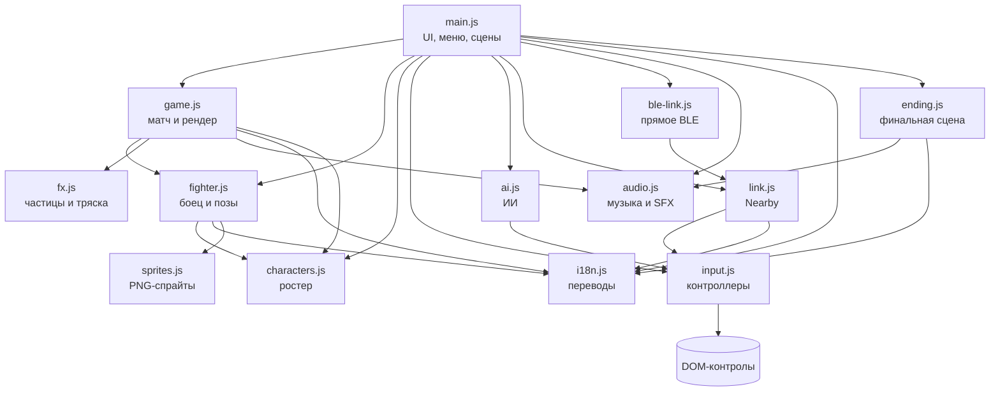
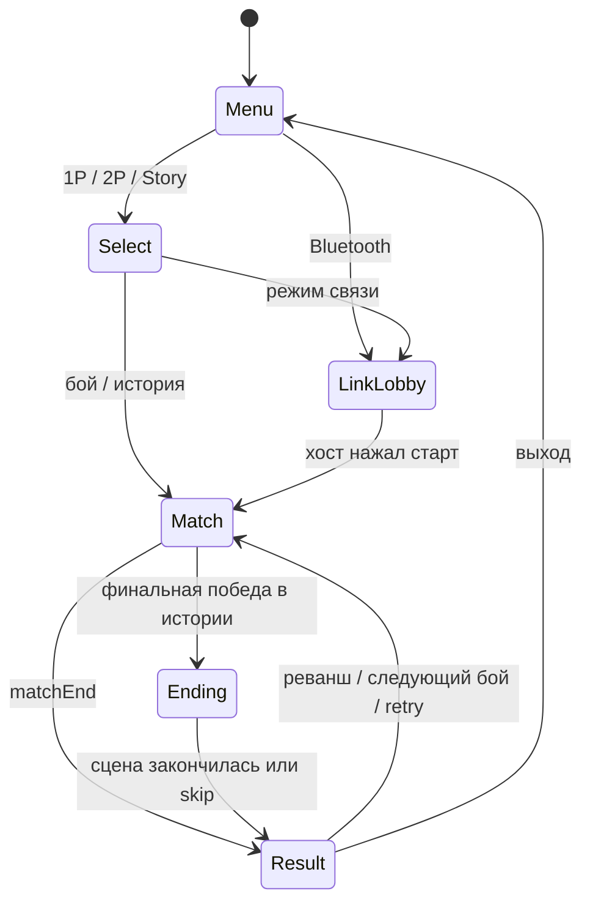

# Архитектура Neon Clash

Документ описывает устройство проекта, поток данных и точки расширения. Если меняешь игровой цикл, сеть или формат ассетов — сначала прочитай соответствующий раздел.

## 1. Обзор

**Neon Clash** — 2D-файтинг на HTML5 Canvas, который запускается в браузере и на Android через Capacitor.

Ключевые решения:

- **Без сборщика.** Вся игра — ES-модули в `www/js/`, подключаемые напрямую из `www/index.html`.
- **Canvas 2D.** Мир рисуется в логическом разрешении `1280×720`; масштаб под экран считается в `Game.resize()`.
- **Один игровой объект.** `Game` хранит состояние матча, бойцов, снаряды, эффекты, камеру, HUD и текущий экран.
- **Хост-авторитетная сеть.** В Bluetooth/BLE-режиме симуляцию считает только хост, гость рендерит снапшоты.
- **Процедурная графика.** Внешние спрайты не обязательны: KAI использует PNG-полосы, остальные бойцы, эффекты и арены генерируются кодом. Если спрайт не загрузился, включается процедурный fallback.
- **Внешняя музыка + синтез.** Музыкальные треки лежат в `www/audio/*.ogg`; если файл недоступен, `audio.js` включает синтезированный fallback. Короткие звуки пока синтезируются.
- **Локализация по умолчанию — английская.** Русский, испанский, португальский, французский, немецкий, китайский и японский подключаются через `i18n.js`.

## 2. Стек

| Слой | Технология |
| --- | --- |
| Игра | HTML5 Canvas 2D, ES modules, WebAudio |
| UI | DOM + CSS-оверлеи поверх Canvas |
| Android | Capacitor 8, нативный WebView |
| Bluetooth / Nearby | `@capacitor-trancee/nearby-connections` |
| Прямое BLE | `@capgo/capacitor-bluetooth-low-energy` |
| PWA | `manifest.webmanifest`, `sw.js` |
| Сборка | Gradle 9.x, AGP 8.13, JDK 21 |
| Пакеты | npm, без бандлера |

## 3. Карта модулей



### Ответственность модулей

| Файл | Ответственность |
| --- | --- |
| `main.js` | Точка входа, переключение оверлеев, выбор режима и бойца, пауза, результат, язык, длина раунда, запуск финальной сцены |
| `game.js` | Матч, фазы раунда, физика столкновений, снаряды, HUD, фоны, история, сетевой guest-рендер |
| `fighter.js` | Состояния бойца, удары, комбо, motion-команды, позы, пиксельно-неоновая отрисовка, портреты |
| `characters.js` | Данные 10 играбельных бойцов и босса: стили, HP, скорость, спец-атаки |
| `input.js` | Абстрактный `Controller`, `MergeController`, сенсорная крестовина, клавиатура |
| `ai.js` | Простой ИИ: дистанция, блок, прыжки, атаки |
| `fx.js` | Частицы, кольца, вспышки, тряска, hitstop |
| `audio.js` | WebAudio: внешние OGG-треки, синтезированный fallback, SFX |
| `i18n.js` | Словари 8 языков, `t()`, `charText()`, `hitsText()`, подстановка DOM-атрибутов |
| `link.js` | Nearby-транспорт, хост-авторитетные снапшоты, интерполяция, авто-реконнект |
| `ble-link.js` | Прямое BLE: GATT-сервер/клиент, чанки, реконнект |
| `sprites.js` | Загрузка PNG-спрайтов, выбор кадра и tint для mirror; сейчас включён для KAI |
| `ending.js` | Ретровейв-финал: кабриолет, закат, сетка, титул, skip |
| `styles.css` | Неоновый UI, адаптив, оверлеи, сенсорные контролы, HUD-панели |
| `sw.js` | Network-first кэш PWA |

## 4. Запуск и жизненный цикл

### 4.1 Инициализация

1. `index.html` загружает `js/main.js` как ES-модуль.
2. `initI18n()` читает `nc_lang` и применяет переводы к DOM.
3. Создаются контроллеры (`makePlayerControllers`), ИИ и `Game`.
4. `Game` создаёт Canvas-контекст, виньетку, запускает `requestAnimationFrame`.
5. Меню показывает оверлей; музыка стартует после первого пользовательского жеста (`audio.unlock()`).

### 4.2 Экраны и переходы



Оверлеи (`#menu`, `#select`, `#help`, `#link`, `#pause`, `#result`, `#ending`) — обычные DOM-элементы. `Game` не управляет ими напрямую: `main.js` синхронизирует классы `hidden` и `in-match`.

## 5. Игровой цикл

`Game.loop(now)`:

1. Считает `dt` в секундах, ограничивает его `0.05` с.
2. `update(dt)` — логика.
3. `render(now/1000)` — отрисовка.
4. Планирует следующий кадр.

### Фазы матча

| Фаза | Что происходит |
| --- | --- |
| `intro` | Баннер раунда, бойцы заблокированы |
| `fight` | Бой, таймер, столкновения |
| `roundEnd` | Баннер K.O./времени, пауза перед следующим раундом |
| `matchEnd` | Итог матча, результат, ожидание действия игрока |
| `idle` | Меню/фон |

Победа в матче — 2 выигранных раунда (`WINS_NEEDED`). Таймер раунда — 75 секунд (`ROUND_TIME`).

### Порядок обновления

1. `updateFighters(dt)`.
2. `updateProjectiles(dt)`.
3. `checkHits()`.
4. Обновление FX и камеры.

Столкновения считаются в `Game.checkHits()` / `Game.resolveHit()`: урон, блок, hitstun, отброс, combo, launch, meter, K.O.

## 6. Бойцы

### 6.1 Данные

`characters.js` экспортирует:

- `CHARACTERS` — 10 играбельных бойцов;
- `CHARACTER_LIST` — массив для выбора и случайного ИИ;
- `BOSS_CHARACTER` — босс `OVERLORD`, не попадающий в выбор;
- `ALL_CHARACTERS` — объединённая карта для `getCharacter(id)`.

Каждый персонаж задаёт:

- `id`, `name`, `style`, `gear`;
- цвета `color` / `accent` / `deep` и альтернативную палитру;
- `hp`, `walkSpeed`, `airSpeed`, `jumpV`;
- модификаторы `damageMul`, `startupMul`, `recoveryMul`, `reachMul`;
- `special` и тексты для UI;
- статы для экрана выбора.

### 6.2 Состояния

`Fighter.update()` обрабатывает:

- `idle`, `walk`, `jump`, `crouch`, `block`;
- `attack`, `hit`, `ko`, `win`.

Атака хранится в `f.attack` с таймингами `startup`, `active`, `recovery`. Хитбокс считает `getAttackBox()`.

### 6.3 Обычные атаки и комбо

Определения — `ATTACKS` в `fighter.js`:

- `punch`, `kick`, `airkick`, `special`;
- спец-варианты: `shockwave`, `dashStrike`, `fan`, `lightning`.

Комбо-цепочки — `COMBOS`. Цепочка продолжается только после попадания. Ввод во время атаки буферизуется (`attackBuffer`), окно продолжения — `chainT`. Поддерживаются:

- P→P, P→K, K→P, P→P→K;
- K→P→K, P→P→P, K→K.

### 6.4 Motion-команды

`Fighter.recordDirections()` запоминает направления относительно взгляда. `detectCommand()` распознаёт:

| Ввод | Действие |
| --- | --- |
| F, F + punch | Rush |
| F, F + kick | Charge |
| D, F + punch | Uppercut |
| D, B + kick | Sweep |
| F, D, B + attack | Breaker |

Команды используют базовые анимации punch/kick, но получают изменённые тайминги, урон, launch и unblockable. Для этого в `startCommand()` модифицируется объект атаки.

### 6.5 Длина раунда

`Game.hitTarget` (8/12/18) масштабирует `maxHealth` в `applyHitTarget()`. Значение выбирается в меню и хранится в `nc_hits`. Это меняет длину раунда, не трогая таймер и урон напрямую.

### 6.6 Босс и история

Босс `OVERLORD`:

- 150 HP до масштабирования;
- `damageMul: 1.4`;
- ускоренные атаки;
- `boss: true`, `scale: 1.09`;
- отдельные рога/аура и boss-музыка.

История строится в `main.js`:

```
все остальные бойцы → зеркальный бой → boss
```

Для 10 бойцов это 9 + 1 + 1 = 11 боёв. После победы показывается `ending.js`, затем экран завершения.

## 7. Ввод

Иерархия:

```text
Controller
├── TouchController          — DOM-крестовина и кнопки
├── KeyboardController       — отладка на ПК
├── MergeController          — объединяет touch + keyboard
├── RemoteController         — состояние кнопок гостя в сетевой игре
└── AIController             — искусственный интеллект
```

`Controller` хранит:

- `state` — удерживаемые действия;
- `presses` — временные метки нажатий для `consume()`.

`MergeController` ищет самое свежее нажатие среди источников. Это позволяет одновременно использовать тач и клавиатуру.

Motion-команды требуют, чтобы `TouchController` и `RemoteController` отправляли `press('left'/'right'/'down')` при входе в направление, а не только `state`. Это реализовано в `setDpadDirs()` и `RemoteController.applyState()`.

## 8. UI, локализация, настройки

### 8.1 i18n

`i18n.js` хранит вложенные словари и предоставляет:

- `t(key, vars)` — строка с подстановкой `{name}`;
- `charText(id)` — имя, tagline, спец, badge, short;
- `hitsText(n)` — склонение серий;
- `applyTranslations()` — обновляет `data-i18n`, `data-i18n-html`, `data-i18n-aria`, `data-i18n-title`;
- `setLang(id)` — сохраняет `nc_lang`, применяет переводы и уведомляет слушателей.

Язык по умолчанию — `en`. Отсутствующий ключ падает обратно на английский.

### 8.2 localStorage

| Ключ | Назначение |
| --- | --- |
| `nc_lang` | язык |
| `nc_char` | последний выбранный боец |
| `nc_transport` | `nearby` или `ble` |
| `nc_hits` | 8 / 12 / 18 |
| `nc_muted` | звук выключен |

### 8.3 Пауза

`renderPauseMoves()` строит карточки P1/P2 с комбо, motion-командами и спец-атакой. В одиночных режимах — один боец, в 2P/link — два. Список скроллится, кнопки паузы остаются видимыми.

## 9. Рендеринг

### 9.1 Слои

`Game.render()`:

1. Очистка Canvas.
2. Смещение камеры (shake).
3. `drawBackground(ctx, t, stageId)`.
4. Отражения бойцов.
5. Бойцы (сортировка KO).
6. Снаряды.
7. FX.
8. Частицы сцены.
9. HUD и баннеры.
10. Low-health vignette и вспышки.

### 9.2 Пиксельно-неоновые бойцы

`drawFighter()` сначала спрашивает `getSpriteFrame()` из `sprites.js`. Если для бойца подключён PNG-лист, рисуется кадр спрайта; иначе используется процедурный путь ниже.

`drawFighter()` не рисует напрямую в основной Canvas:

1. Создаёт/переиспользует offscreen `420×400`.
2. Рисует тело в уменьшенном разрешении (`PIXEL_RES = 0.43`).
3. Выводит результат через `drawImage` с `imageSmoothingEnabled = false`.

Это даёт пиксельные края при сохранении процедурной анимации. Внутри:

- `buildPose()` — скелет и позы;
- `drawTorso`, `drawHead`, `drawExtremities` — тело;
- `drawGearBack/Front` — оружие и броня;
- `drawCostumeBack`, `drawCostumeLegs`, `drawCostumeArms`, `drawJacketDetails` — одежда;
- `drawHeadGear()` — уши, рога, кристаллы, визоры.

`drawFighterPortrait()` рисует голову и плечи для HUD.

### 9.3 Арены

`STAGE_IDS = ['city', 'dojo', 'reactor', 'orbit', 'tundra']`.

`pickStageId()` выбирает сцену без немедленного повтора. `drawBackground(ctx,t,stageId)` диспетчеризует пять процедурных фонов. Гость получает `st` из снапшота.

### 9.4 HUD

`drawHUD()`:

- портреты P1/P2 (`drawFighterPortrait`);
- полосы HP, энергия, имя, `HP current / max`;
- пипсы раундов, таймер, номер раунда;
- серия/комбо;
- глава истории.

### 9.5 Финал

`ending.js` создаёт отдельный Canvas-оверлей. Сцена рисуется процедурно: закат, сетка, пальмы, кабриолет, герой. `playEnding()` возвращает `Promise`, которую `main.js` ждёт перед показом результата. Есть `SKIP`.

## 10. Сеть

### 10.1 Транспорты

| Транспорт | Плагин | Особенности |
| --- | --- | --- |
| Nearby | `@capacitor-trancee/nearby-connections` | Bluetooth + Wi-Fi, 30 снапшотов/с |
| BLE | `@capgo/capacitor-bluetooth-low-energy` | GATT, чанки, 8 снапшотов/с |

`BleLinkManager` наследует `LinkManager` и переопределяет транспортные методы.

### 10.2 Протокол

```text
host → guest: hello, start, resume, snap, rematch, bye
guest → host: hello, input, rematch, bye
```

Хост:

- симулирует матч;
- применяет ввод гостя через `RemoteController`;
- отправляет снапшот: бойцы, HP, энергия, атаки, снаряды, таймер, раунды, арена, label комбо.

Гость:

- не симулирует бой;
- отправляет состояние кнопок;
- рендерит снапшоты с jitter-буфером.

### 10.3 Интерполяция

`Game.receiveSnapshot()` складывает снапшоты в `_snapBuf`. В `update()`:

- адаптивная задержка `90–200 мс`;
- поиск пары снапшотов вокруг `now - delay`;
- `blendSnapshots()` интерполирует позиции бойцов и снарядов;
- дискретные поля берутся из свежего снапшота.

### 10.4 BLE-чанки

Сообщение режется на пакеты:

```text
[id:2][index:1][count:1][payload...]
```

Хост шлёт по 20 байт (безопасный MTU). Гость поднимает MTU до 517 и может писать крупнее.

### 10.5 Авто-реконнект

`handleDisconnected()`:

1. Ставит матч на паузу.
2. Включает `reconnecting`.
3. Хост снова рекламируется, гость ищет/переподключается.
4. В течение 15 секунд пытается восстановить связь.
5. При успехе хост отправляет `resume` со снапшотом.
6. При неудаче — возврат в лобби.

## 11. Аудио

`audio.js`:

- `TRACKS` — синтезированные темы и fallback;
- `MUSIC_FILES` — карта OGG-файлов;
- `setMusic(id)` — переключение сцены;
- `playFileTrack()` — fetch → `decodeAudioData` → loop;
- `startSynthMusic()` — старый синтезатор, если файла нет;
- `stopMusic()` / `setMuted()` — остановка и mute;
- SFX-методы: `hit`, `block`, `whiff`, `jump`, `specialCharge`, `fire`, `shockwave`, `dash`, `shard`, `thunder`, `ko`, `round`, `fight`, `win`, `timeout`, `combo`, `command`.

Карта треков:

| ID | Файл | Сцена |
| --- | --- | --- |
| `menu` | `audio/menu.ogg` | меню, выбор, лобби |
| `stage_city` | `audio/battle_city.ogg` | Neon City |
| `stage_dojo` | `audio/battle_dojo.ogg` | Sunset Dojo |
| `stage_reactor` | `audio/battle_reactor.ogg` | Toxic Reactor |
| `stage_orbit` | `audio/battle_orbit.ogg` | Orbit Station |
| `stage_tundra` | `audio/battle_tundra.ogg` | Frozen Tundra |
| `boss` | `audio/battle_boss.ogg` | босс |
| `victory` | `audio/victory.ogg` | результат победы |

Формат и правила ассетов — в [ASSETS.md](ASSETS.md).

## 12. Точки расширения

### Добавить бойца

1. Добавить запись в `CHARACTERS` в `characters.js`.
2. Добавить `char.<id>.*` во все языки `i18n.js`.
3. Добавить карточку в `index.html` с `data-char`.
4. Добавить CSS-цвета `.fighter-card[data-char="..."]`.
5. При необходимости — новый `gear` в `drawHeadGear`/`drawGearBack`/`drawGearFront`.
6. Проверить историю: список соперников строится из `CHARACTER_LIST` автоматически, но общее число боёв изменится.

### Добавить арену

1. Добавить id в `STAGE_IDS` (`game.js`).
2. Написать `draw<Name>Background`.
3. Добавить case в `drawBackground`.
4. Добавить BLE-код в `STAGE_CODES`.
5. Добавить трек в `MUSIC_FILES` и `www/audio`.
6. Обновить README.

### Добавить язык

1. Добавить `{ id, label }` в `LANGS`.
2. Добавить полный словарь в `messages`.
3. Проверить `charText` и `hitsText`.
4. Проверить длинные строки на телефоне.

### Добавить музыку/SFX

См. [ASSETS.md](ASSETS.md).

## 13. Сборка

```bash
npm install
npm run dev          # локальный сервер
npm run apk          # cap sync + Gradle + dist/NeonClash-MVP.apk
```

`npm run apk`:

1. запускает `scripts/fix-ble-gradle.mjs`;
2. `npx cap sync android`;
3. `./gradlew assembleDebug`;
4. копирует APK в `dist/NeonClash-MVP.apk`.

После любых изменений в `www/` нужен `cap sync`, иначе APK соберётся со старым WebView-контентом.

## 14. Известные ограничения

- Нет сохранения прогресса истории между запусками.
- Нет полноценного rollback netcode: хост-авторитетная модель + интерполяция.
- BLE-транспорт чувствителен к MTU и качеству стека конкретного телефона.
- Спрайтовый рендер включён для KAI: `www/sprites/kai/` + `sprites.js`. Остальные бойцы процедурные; формат и бриф — в `ASSETS.md` и `CHARACTER_KAI.md`.
- Реальный сетевой матч двух телефонов нужно проверять на физических устройствах.
- Внешние SFX пока не подключены — синтезируются WebAudio.
